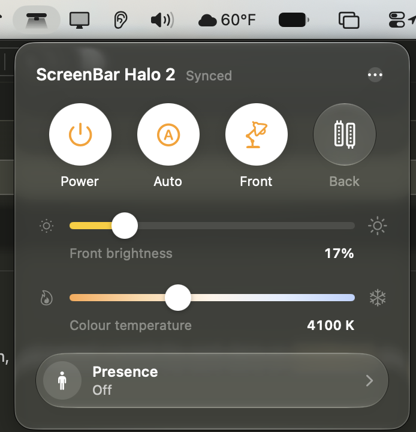
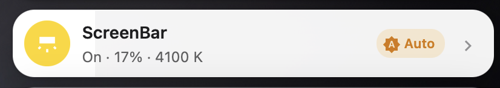
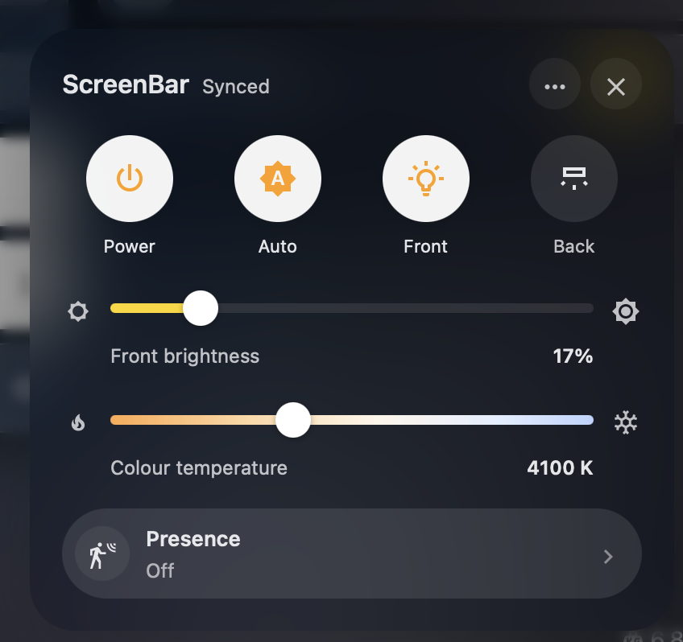

# ScreenBar Halo 2 Companion

A macOS menu bar app and a Home Assistant card for the **BenQ ScreenBar Halo 2**, laid out like
BenQ's iScreenBar app. Both drive the lamp through the ESPHome radio bridge from
[NickCao/benq-screenbar-halo2-esphome](https://github.com/NickCao/benq-screenbar-halo2-esphome):
a Waveshare ESP32-S3-LR1121 board that speaks the lamp's 2.4 GHz protocol. Set up that bridge first;
this repository only adds the two front ends.


[](https://buymeacoffee.com/rchen14b)

## Screenshots

### macOS menu bar


### Home Assistant: tile and drawer




## Features

Both have the same controls:

- **Power**, **Auto** brightness, and the **Front** and **Back** sections (Front, Back or both lit).
- **A brightness slider for each lit section.** The lamp keeps a level per section and ignores the
  level of an unlit one, so you get one slider for Front or Back alone and two when both are lit.
- **Colour temperature**, 2700–6500 K, shared by both sections.
- **Presence**: off, or turn the lamp off after 3, 5, 10 or 15 minutes away (the lamp's ultrasonic
  sensor).
- **Sliders send once, on release**, so a drag is one radio command.
- **The bridge's status** in the header: Synced, Sending…, Pairing…, or the problem.

## What you need

- A ScreenBar Halo 2 with its wireless controller.
- The bridge from [NickCao/benq-screenbar-halo2-esphome](https://github.com/NickCao/benq-screenbar-halo2-esphome),
  flashed, paired with the lamp and added to Home Assistant. Its README covers the hardware, the
  firmware build and pairing.

Both front ends find the bridge's entities by the names its firmware gives them: the light,
*Lighting mode*, *Ultrasonic sensor*, *Front brightness*, *Back brightness*, *Auto brightness* and
*Radio status*.

**Auto brightness.** The bridge firmware has an *Auto brightness* button, which starts Auto. With it,
the Auto control lights up briefly when pressed. If your bridge also has an *Auto brightness*
**switch** (on/off, following the lamp's status replies; a small firmware addition that isn't
upstream yet), both front ends use it, and Auto stays lit while it's on.

## macOS menu bar app

The app talks to the bridge **directly**, over ESPHome's encrypted native API: the same connection
Home Assistant uses. It keeps working while Home Assistant is down, and Home Assistant stays in sync
because the bridge reports every change to all its clients. The menu bar icon is a light bar, with a
beam while the lamp is on.

Requires macOS 26 or later and Xcode 26 (Swift 6).

```sh
scripts/build-app.sh             # builds build/ScreenBar.app (signed ad hoc)
scripts/build-app.sh --install   # also copies it to ~/Applications and launches it
```

Then open the panel, choose **… → Settings…**, and enter:

- **Bridge address:** `screenbar-halo2.local` by default, or its IP address.
- **API encryption key:** the `api: encryption: key:` the bridge was built with. It is stored in the
  login Keychain.

Settings also has **Open at login**. macOS asks once whether ScreenBar may find devices on the local
network: allow it.

If the key is in an ESPHome secrets file as `api_encryption_key`, this launches the app with it
instead of typing it:

```sh
scripts/import-credentials.sh path/to/secrets.yaml [bridge-host]
```

`esphome-probe` is a read-only check of the API client against your bridge: it lists the entities
and the states that arrive within a few seconds, and sends no commands.

```sh
SCREENBAR_KEY=<api encryption key> swift run esphome-probe [bridge-host] [seconds]
```

## Home Assistant card

1. Copy [`home-assistant/screenbar-halo2-card.js`](home-assistant/screenbar-halo2-card.js) to
   `/config/www/` on your Home Assistant.
2. Add it as a dashboard resource: **Settings → Dashboards → ⋮ → Resources → Add resource**, URL
   `/local/screenbar-halo2-card.js`, type *JavaScript module*.
3. Add the card to a dashboard:

```yaml
type: custom:screenbar-halo2-card
entity: light.screenbar
```

On the dashboard it is one compact tile: the icon toggles the lamp, and the rest of the tile opens
the control drawer (a bottom sheet on phones).

| Option | Default | |
|---|---|---|
| `entity` | (required) | The bridge's light |
| `name` | `ScreenBar` | Title on the tile and in the drawer |
| `lighting_mode` | `select.<id>_lighting_mode` | `<id>` is the light's object ID, e.g. `screenbar` |
| `ultrasonic` | `select.<id>_ultrasonic_sensor` | |
| `front_brightness` | `number.<id>_front_brightness` | |
| `back_brightness` | `number.<id>_back_brightness` | |
| `auto_brightness` | `switch.<id>_auto_brightness` if it exists, else `button.<id>_auto_brightness` | |
| `radio_status` | `sensor.<id>_radio_status` | |

The card follows your Home Assistant theme. To restyle the "on" state, set any of
`--screenbar-card-active-surface`, `--screenbar-card-active-ink`, `--screenbar-card-active-fill`,
`--screenbar-card-active-icon-background` and `--screenbar-card-active-icon-color` in your theme.

## How the app works

| Path | Purpose |
|---|---|
| `Sources/ESPHomeAPI/Noise.swift` | The `Noise_NNpsk0_25519_ChaChaPoly_SHA256` handshake and transport ciphers (CryptoKit) |
| `Sources/ESPHomeAPI/Protobuf.swift` | The protobuf subset the API messages need |
| `Sources/ESPHomeAPI/ESPHomeClient.swift` | Connection, entity list, state stream, commands for lights, selects, numbers, switches and buttons, pings, reconnects |
| `Sources/ScreenBarMenu/` | The app: the store (entities matched by name), panel, settings and icon |
| `Sources/esphome-probe/` | The read-only test tool |
| `home-assistant/` | The Home Assistant card: one file, no build step |

Message IDs and fields follow ESPHome 2026.9's `api.proto` and the Noise frame helper of
[aioesphomeapi](https://github.com/esphome/aioesphomeapi). The app uses no third-party packages.

## Credits

- **[NickCao/benq-screenbar-halo2-esphome](https://github.com/NickCao/benq-screenbar-halo2-esphome)**,
  the ESPHome bridge this all runs on: the hardware setup on the Waveshare ESP32-S3-LR1121, the
  LR1121 radio driver, lamp polling, and the protocol reference. It builds on
  [Termina1/benq-screenbar-halo2-esphome](https://github.com/Termina1/benq-screenbar-halo2-esphome).
- **[kuzmin-no/BenQ_ScreenBar_HALO_2_HA_integration](https://github.com/kuzmin-no/BenQ_ScreenBar_HALO_2_HA_integration)**,
  the original reverse engineering of the Halo 2's radio protocol.
- The layout follows BenQ's iScreenBar app.

This is an unofficial community project, not affiliated with or endorsed by BenQ. BenQ and ScreenBar
are trademarks of their respective owner.

## License

MIT. See [LICENSE](LICENSE).
